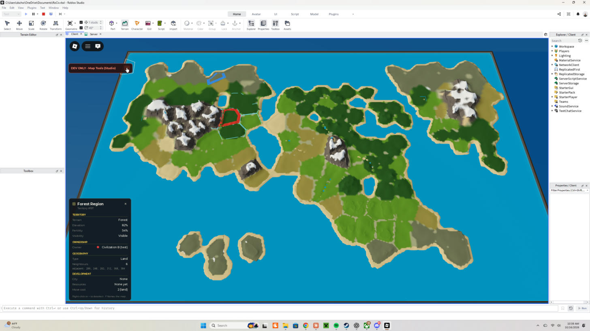
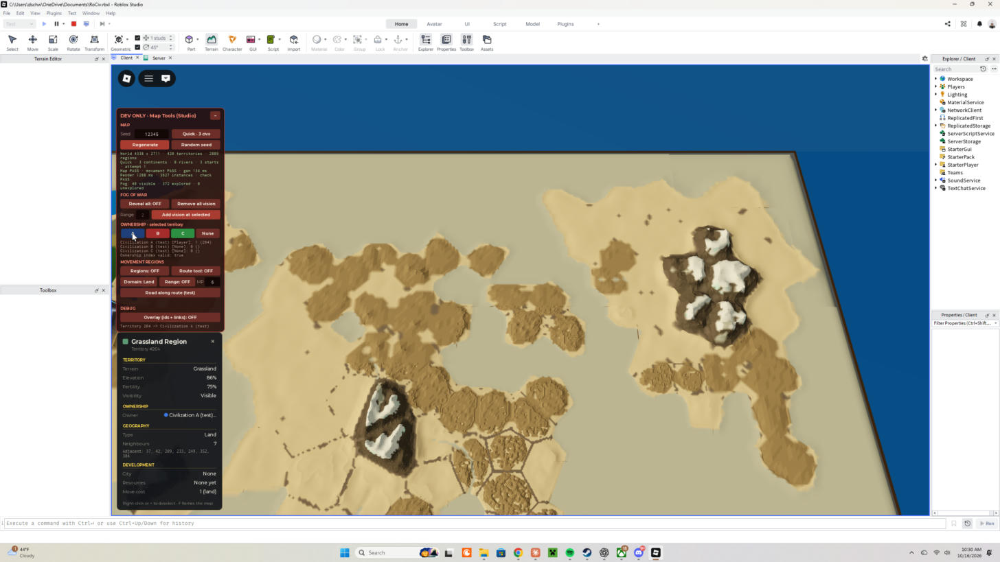

# Map v2 report: match sizes, geography, terrain and fog

This pass finishes the map before Phase 4. Everything here was run and checked in Roblox Studio (Play mode, server and client). Where something is approximate or still weak, it says so below.

## 1. Map size tied to match size

Each map size is a match preset in `MapConfig.MATCH_SIZES`. The Studio dev panel has a size button (Quick, then Standard, then Long).

| Preset | Civs | Territories | World (studs) | Land territories | Continents (target, measured) | Rivers | Lakes |
|---|---|---|---|---|---|---|---|
| Quick | 3 | 420 | 4338 × 2711 | 154–163 | target 2–3, measured 2–3 | 8 | 3 |
| Standard | 6 | 720 | 5679 × 3550 | 270–290 | target 3–4, measured 3–4 | 13 | 5 |
| Long | 8 | 1000 | 6693 × 4183 | 383–398 | target 4–5, measured 4–5 | 18 | 7–8 |

Territories are also bigger than before: about 170 studs across, up from 125 (`TERRITORY_AREA` went from 16000 to 28000). That gives the terrain room for detail.

A Quick map has about 50 land territories per player and always at least two continents.

**Continent rule.** A landmass counts as a continent when it has at least 18 territories and at least 8% of all land. Anything smaller is an island.

**Guarantee.** Generation checks the continent count and the number of start positions. If either falls short, it regenerates from a seed derived deterministically from the original. Since adding straits between continents (section 2), every tested seed passed on the first attempt.

**Start positions.** There is one start per civilization, on a continent, never on water, mountains, tundra or desert. Starts are at least 4 land hops apart (or on different landmasses), spread round-robin across continents, and scored by nearby land, fertility and rivers. Each player's opening vision is now centred on their civilization's start, not the map centre.

## 2. Geography

The elevation field is built from shapes instead of plain noise:

- **Continents:** domain-warped ellipses, spread apart.
- **Peninsulas:** capsules reaching out from a continent's coast.
- **Bays:** notches cut into coasts.
- **Archipelagos:** clusters of 4–7 small islands placed away from the continents.
- **Mountain ranges:** ridged noise, applied on land only.

Where land from two different shapes touches, the lower side becomes sea. This forms straits, so continents can't merge by accident. Merging was why Standard and Long missed their continent counts before this fix.

**Lakes.** Lakes are a new `Lake` terrain type: inland water that never touches the sea, kept 2 hops away from other water. Movement treats it as water. The validator checks it.

**Rivers.** A river starts deep inland on high, damp ground and steps one territory closer to the nearest water each move, so every river ends in the sea or a lake. Each river territory stores its own stretch of the river course, which is sent to clients only once that territory is explored.

Rivers have gameplay effects:
- +0.15 fertility.
- Entering a river territory costs +0.5 movement (`RIVER_MOVE_COST`). A road removes the penalty.

## 3. Terrain renderer (Humankind-style)

Known territories are now real Roblox voxel terrain, written on the client by the new `src/client/TerrainPainter.luau`. The terrain includes:
- rolling grassland
- golden plains
- forest canopy
- dunes
- tundra with snow patches
- mountain ranges with rock and snowy peaks
- beaches
- water with a sea floor, lakes, and river valleys

Painting rules:
- Each territory owns its 4-stud columns, and painting a territory rewrites only its own columns.
- Heights blend toward known neighbours at borders, so land is continuous.
- An unknown neighbour counts as "same as me", so no hidden information is used.
- When a territory becomes known, its known neighbours are repainted so their shared borders match.
- Painting is queued and runs within a per-frame budget, so big reveals build up progressively.

**Borders and outlines.** Owner borders, selection outlines and neighbour outlines follow the terrain surface. Owner borders are now bold: an 8-stud line plus a translucent band in the civilization's colour.

**Lighting.** A warm afternoon sun with soft shadows, so the relief reads from strategy height.

**Clicks.** Clicks raycast against the terrain and the parchment slabs (no parallax error on hills). The flat plane is the fallback.

## 4. Fog of war (Civilization VI style)

| State | Look |
|---|---|
| Unexplored | Flat parchment plateau (one slab per territory, aged-paper tint) with brown ink lines between territories. No terrain at all. |
| Explored | The same relief in sepia materials (tan land, brown forest, darker highlands, pale peaks, grey-blue water, ink-brown borders). Last-known owner borders are drawn faded toward sepia. |
| Visible | Full-colour terrain and real water. |

**Fog safety:**
- The server still sends terrain, owner and river data only for explored territories.
- The client paints voxels only from that data.
- A new voxel-level check (`MapRenderer.deepFogCheck`, run in Studio through the `RunFogCheck` player attribute) reads every unexplored territory's columns and fails if any terrain is there.

## 5. Test results (Studio, this session)

| Test | Result |
|---|---|
| Generator plus validator: 3 sizes × 5 seeds (12345, 777, 2024, 9001, 31337) | 15/15 PASS on the first attempt. Continent targets met, all starts placed, rivers and lakes valid. |
| Movement graph built and validated on all 15 maps | 15/15 OK. Server route self-test 40/40. |
| Determinism (Long, seed 55, generated twice) | Same fingerprint (`7215b05c`). |
| Generation time | Quick about 115 ms, Standard about 225 ms, Long about 320 ms. |
| Client render check after load, reveal, explore and ownership changes | PASS |
| Deep fog check at game start (372 unexplored territories) | 0 leaks |
| Fault injection: voxels written into an unexplored territory | Check reported 1 leak, as expected |
| Long map, full reveal | 1113 paints, 24.1 M voxels in about 25 s (progressive). Then 60 FPS, about 8.8k map instances, 15.9 M terrain cells. |
| Ownership (A and B), selection, neighbour outlines on terrain | Visible and following the surface |
| Dev panel size selector: Quick, Standard, Long regenerate | Works. Test civilizations rebuild to match (3, 6 or 8). |

The validator gained new checks:
- lakes must not touch the sea
- landmass labels must match land connectivity
- the continent minimum per size
- rivers must be valid land chains ending at water
- the number of starts, their placement, and their spacing

The pairwise adjacency check now uses a sweep, so validating 1000 territories stays fast.

## 6. Known limitations

- **Big reveals are slow.** Painting costs about 20 ms per territory, so mass reveals (dev Reveal All, Long size) go over the frame budget while they build. Normal play reveals a few territories at a time.
- **Water is one colour.** Roblox water has a single colour, so coasts are not turquoise like Humankind's. Shallow water only shows a lighter sea floor faintly.
- **Neutral borders are subtle.** Borders between unowned land territories are voxel lines and look faint or dashed in places. Owner borders are the strong, clear ones.
- **Rivers are short on narrow continents.** Typically they cross 2–4 territories.
- **No design plugins were used.** The Studio Plugins tab showed no plugins this session. Everything was built with Studio's built-in tools and code. If you install specific plugins, tell me which and I can use them.
- **Studio viewport can show grey.** Right after Play, the Studio viewport sometimes stays grey until the Studio window gets focus and input. This is Studio throttling, not the game.
- **The place file has not been saved.** The scripts in the open `RoCiv.rbxl` are synced to this commit, the Edit-mode terrain is empty, and the lighting is restored. Save the place (Ctrl+S) to keep it.

## 7. Files

**New**
- `src/client/TerrainPainter.luau`
- `docs/MAP_V2_REPORT.md`
- `docs/images/*`

**Rewritten**
- `src/server/Map/MapGenerator.luau`: presets, grid-accelerated Voronoi, geography, lakes, rivers, starts, retries
- `src/client/MapRenderer.luau`: parchment slabs plus terrain, terrain-following outlines, new validation

**Updated**
- `MapConfig`: match sizes, terrain and fog settings, lighting
- `TerrainTypes`: Lake; decoration fields removed
- `MapValidator`
- `MapService`: match size, starts, river paths, test civilizations per size
- `VisibilitySystem`: start resolver
- `CivilizationSystem`: up to 8 test civilizations
- `Pathfinding` and `MovementGraph`: river cost
- `ClientMapState`: river paths
- `TerritoryStyle`: parchment and sepia
- `SelectionController`: terrain picking, surface redraw
- `MovementClient`, `DebugOverlay`: terrain heights
- `DevMapPanel`: size selector
- `ClientMain`: lighting, fog check hook
- `tools/StudioSync.lua`
